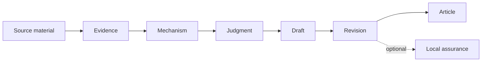

<div align="center">

# Writing Best Practices

**Research deeply. Reason clearly. Write with precision.**

An editorial skill and local-first CLI for evidence-grounded writing, fiction, and AI-assisted revision.

[](#release-status)
[](package.json)
[](LICENSE)
[](#quick-start)

[Quick start](#quick-start) · [Writing skill](#use-the-writing-skill) · [Examples](#what-better-writing-looks-like) · [Evaluation](#editorial-evaluation) · [Documentation](#documentation)

</div>

---

## Beyond anti-slop

A clean sentence cannot rescue a weak argument. Writing Best Practices starts with the evidence, the mechanism and the author's judgment, then edits the language. It combines task-specific writing guidance with deterministic local checks, without confusing either with independent editorial approval.

| Research & reasoning | Editorial craft | Local assurance |
|:---|:---|:---|
| Source reconciliation | Authorial voice | Read-only lexical scans |
| Causal and marginal analysis | Argument progression | Version-safe revisions |
| Strategic interaction | Fiction and scene causality | Evidence and release gates |
| Forecast accountability | Bilingual compression | Regression tests |

## How it works



The skill guides a writing agent; the CLI inspects artifacts. Neither independently establishes the truth of a source or guarantees publication quality.

## Quick start

Requires Node.js 20+. Clone the repository or extract the release archive.

```bash
git clone https://github.com/jinkanglow/Writing_Best_Practice.git
cd Writing_Best_Practice
node bin/writing-quality.js analyze examples/article.md --output report.json
npm run knowledge:check
npm run check
```

No runtime dependencies are declared. The package is private and is not advertised as an npm release.

## Use the writing skill

Open [SKILL.md](SKILL.md) in your writing agent and make the repository's referenced files available to it. Installation paths depend on the host. Example request:

> Rewrite my financial analysis using Writing Best Practices. Preserve every material fact and my supported thesis. Explain the mechanism, integrate the strongest counterargument, and remove redundant prose. Return the complete article, not an audit transcript.

| Task | Start here |
|---|---|
| Financial, macro, political and technical research | [Editorial decision guide](references/editorial-decision-guide.md) |
| Strategic insight and applied knowledge | [Editorial intelligence practice](references/editorial-intelligence-practice.md) |
| Rewrite and compression | [Evidence-preserving compression](references/evidence-preserving-compression.md) |
| Fiction | [Character causality](references/character-causality.md) |
| Combine skills | [Fusion workflow](docs/FUSION-WORKFLOW.md) |
| Chinese editing | [Chinese anti-slop guidance](references/anti-slop-chinese.md) |

## What better writing looks like

Illustrative example using synthetic financial data, not a measured model comparison.

**Before**

> The company experienced strong revenue growth, but profitability remained under pressure, raising important questions about its future performance.

**After**

> Revenue rose from 100 million to 120 million while operating profit fell from 20 million to 18 million. Operating margin declined from 20% to 15%. Growth has not yet produced incremental operating profit; the next question is whether the additional costs recur.

The revision adds a reproducible calculation and a decision-relevant research question. It does not invent the cause of the cost increase.

## Local tools

```bash
npm run anti-slop:scan
npm run fusion:audit
npm run production:smoke
```

Lexical matches are review candidates, not evidence of AI authorship. For detailed commands and release workflows, see the [complete CLI guide](README-CLI.md).

## Editorial evaluation

The [RC13 research corpus](benchmarks/editorial-quality-rc13/README.md) contains four historical source packets: Apple earnings, US GDP, EU AI regulation and a Cloudflare outage. RC14 preview retains the corpus and provides an explicit [qualification checklist](benchmarks/editorial-quality-rc14/README.md).

| Evidence | Status |
|---|---|
| Historical engineering regression | See local `npm run check` |
| Knowledge integrity | See local `npm run knowledge:check` |
| Controlled RC11/RC12/RC13 generation | Not run (0/72) |
| Independent blind review | Not run |
| Publication qualification | Not ready |

## Repository map

```text
SKILL.md       Agent entry point
skills/        Specialized writing guidance
references/    Editorial knowledge
profiles/      Genre-specific defaults
rules/         Machine-readable constraints
bin/           CLI entry point
src/           Local implementation
scripts/       Audit and evaluation commands
benchmarks/    Research and regression cases
tests/         Automated tests
docs/          Detailed documentation
```

## Documentation

- [Knowledge architecture](docs/KNOWLEDGE-ARCHITECTURE.md)
- [Editorial orchestration](docs/EDITORIAL-ORCHESTRATION.md)
- [Production hardening](docs/PRODUCTION-HARDENING.md)
- [Development history](docs/DEVELOPMENT-HISTORY.md)
- [Complete CLI and historical README](README-CLI.md)

## Release status

**v11.8 RC14 preview** is a documentation and qualification-preparation package based on RC13. It does not claim empirical editorial qualification. Model comparison, independent review and failure-driven changes remain pending. The underlying package retains RC13 metadata until qualification work is implemented.

## Contributing

Report reproducible defects with a source packet, expected behavior, actual output and the relevant command. For editorial issues, include exact passages and explain the lost fact, invalid inference or unnecessary repetition. Run `npm run check` before submitting changes.

## License

[MIT](LICENSE).
