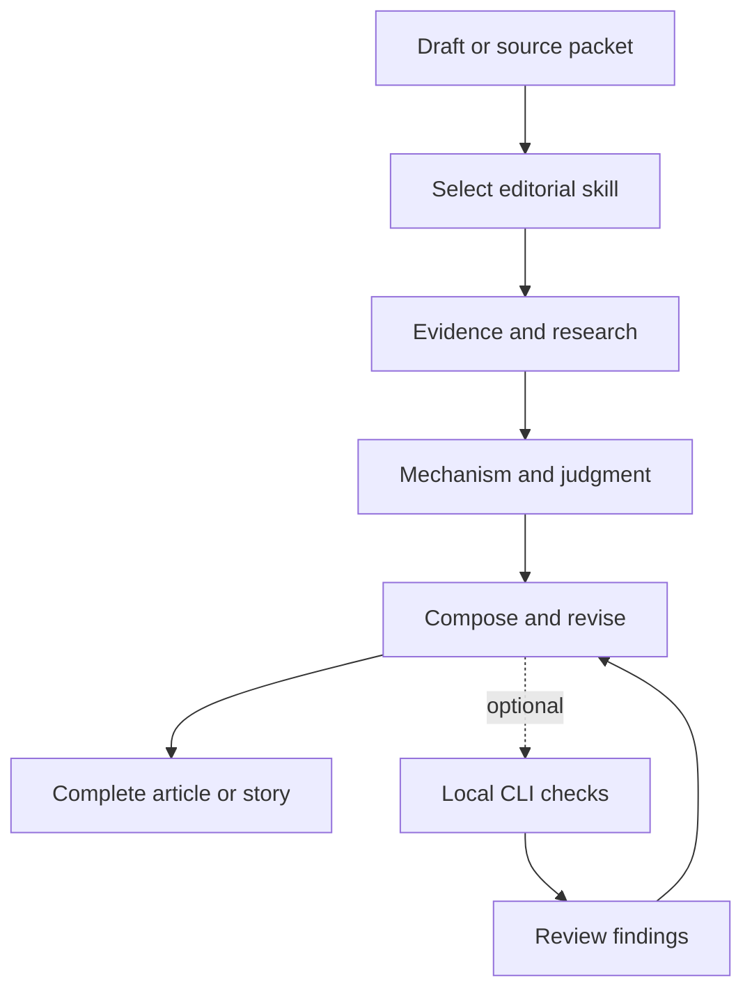

<div align="center">

# ✒️ Writing Best Practices

### Better thinking. Better writing.

**An open-source editorial skill and local-first CLI for research, nonfiction, fiction and AI-assisted revision.**

[](#release-status)
[](package.json)
[](LICENSE)

[](#quick-start)
[](package.json)
[](#writing-skill)

[**Get started**](#quick-start) · [**See examples**](#before--after) · [**Explore features**](#core-capabilities) · [**CLI reference**](#cli-reference) · [**Evaluation**](#editorial-evaluation)

</div>

---

## Why Writing Best Practices?

A polished sentence cannot rescue a weak argument. A financial article can sound authoritative while confusing revenue with profit. A novel can contain elegant dialogue while its characters make decisions that have no credible cause.

Writing Best Practices addresses both the thinking and the prose. It gives writing agents task-specific editorial guidance and provides local tools for inspecting drafts, evidence and revisions.

> **The deliverable is the finished article or story — not a transcript of the editorial process.**

## Before & after

**Financial research · illustrative synthetic data**

| Before | After |
|:--|:--|
| The company experienced strong revenue growth, but profitability remained under pressure, raising important questions about its future performance. | Revenue rose 20%, from 100 million to 120 million, while operating profit fell from 20 million to 18 million. Operating margin declined from 20% to 15%. The question is whether the additional costs recur. |

The revision calculates the margin change, identifies a research question and avoids inventing a cause.

<details>
<summary><strong>中文示例 · Chinese financial commentary</strong></summary>

**Before:** 公司收入强劲增长，但盈利能力仍面临压力，未来发展值得关注。

**After:** 收入增长20%，经营利润却由2000万降至1800万，经营利润率从20%降至15%。新增收入未能带来新增经营利润，下一步应检验新增成本是否具有持续性。

</details>

These examples illustrate the intended editorial approach, not measured model performance.

## Core capabilities

| Capability | What you can do |
|:--|:--|
| 🔎 Research intelligence | Reconcile sources, identify material variables and formulate research questions. |
| 📊 Financial & strategic analysis | Examine marginal economics, binding constraints, competitive responses and bounded forecasts. |
| 🧭 Editorial judgment | Preserve supported authorial positions, test alternative explanations and develop independent analysis. |
| ✍️ Writing craft | Improve argument progression, narrative causality, voice, rhythm and compression. |
| 🧩 Skill fusion | Combine primary writing obligations with style constraints in a single draft. |
| 🛡️ Local assurance | Inspect lexical matches, explicit contracts, evidence records and version-bound revisions. |

## How it works



The writing agent handles composition and semantic judgment; the local CLI performs specified deterministic checks. Neither substitutes for source verification or independent editorial review.

## Quick start

Requires Node.js 20+. Clone the repository or extract the release archive.

```bash
git clone https://github.com/jinkanglow/Writing_Best_Practice.git
cd Writing_Best_Practice
node bin/writing-quality.js analyze examples/article.md --output report.json
npm run knowledge:check
npm run check
```

No runtime dependencies are declared. The package is private and is not advertised as an npm release.

## Writing skill

Open [SKILL.md](SKILL.md) in your writing agent and make the repository's referenced files available to it. Installation paths depend on the host. Example request:

> Rewrite my financial analysis using Writing Best Practices. Preserve every material fact and my supported thesis. Explain the mechanism, integrate the strongest counterargument, and remove redundant prose. Return the complete article, not an audit transcript.

| Task | Start here |
|---|---|
| Financial, macro, political and technical research | [Editorial decision guide](references/editorial-decision-guide.md) |
| Strategic insight and applied knowledge | [Editorial intelligence practice](references/editorial-intelligence-practice.md) |
| Rewrite and compression | [Evidence-preserving compression](references/evidence-preserving-compression.md) |
| Fiction | [Character causality](references/character-causality.md) |
| Combine skills | [Fusion workflow](docs/FUSION-WORKFLOW.md) |
| Chinese editing | [Chinese anti-slop guidance](references/anti-slop-chinese.md) |

### Example agent request

```text
Apply Writing Best Practices to this draft.
Preserve material facts and my supported thesis.
Explain the mechanism and strongest counterargument.
Remove repeated arguments and unnecessary wording.
Return the complete revised article.
```

## CLI reference

<details>
<summary><strong>Expand the complete command guide</strong></summary>

### Skill fusion

**One final article, not a stack of checklists.** A primary skill controls the story or argument; a constraint skill controls how that material is written. The output is the integrated draft, while the plan and audit stay behind the scenes.

```bash
node scripts/fusion-plan.js audit --plan examples/fusion/romance-plan.json --output fusion-report.json
node scripts/fusion-plan.js verify --plan examples/fusion/romance-plan.json --report fusion-report.json
```

The audit verifies mappings and required decisions. It cannot certify emotional credibility or prose quality. See the [fusion protocol](references/fusion-protocol.md), [anti-slop review](references/fusion-anti-slop.md), and [full workflow](docs/FUSION-WORKFLOW.md).

### Anti-slop scanner

Review recurring filler and formulaic phrases without treating them as proof of AI authorship. The scanner is **read-only**; it reports matches and preserves editorial exceptions.

```bash
node scripts/anti-slop-catalog.js scan --file examples/article.md --profile analytical-nonfiction --output catalog-report.json
node scripts/anti-slop-catalog.js verify --file examples/article.md --profile analytical-nonfiction --report catalog-report.json
```

Fenced code, blockquotes, and inline code are excluded. A match is a review candidate, not an automatic deletion instruction. Explore the [catalog](rules/anti-slop-catalog.json), [wording guidance](references/banned-words.md), [semantic review](references/anti-slop-semantic.md), and [before/after edits](examples/anti-slop-before-after.md).

### Writing workflows

#### 1. Inspect a draft

```bash
node bin/writing-quality.js analyze examples/article.md \
  --output .writing/report.json
```

Find deterministic rule matches without confusing them with a semantic assessment of the entire article. The analyzer uses conservative Markdown classification; it is not a complete CommonMark parser.

#### 2. Combine explicit writing constraints

```bash
node bin/writing-quality.js skill validate examples/primary-skill.md

node bin/writing-quality.js fuse-skills \
  --primary examples/primary-skill.md \
  --constraint examples/constraint-skill.md \
  --output .writing/fusion.json
```

The CLI reconciles **explicit `writing-contract` blocks**, not arbitrary natural-language instructions. In the supplied example, a deliberate conflict produces a nonzero exit status; resolve it instead of silently discarding a requirement.

#### 3. Revise without overwriting the original

```bash
node bin/writing-quality.js patch propose examples/article.md \
  --start 0 --end 1 --replace X

# Save the proposal as patch.json, then:
node bin/writing-quality.js patch apply examples/article.md \
  --patch patch.json --output revised.md
```

Patches use UTF-8 **byte offsets** and the original document hash. Stale edits, invalid byte boundaries, and existing output files are rejected. The sample offset is illustrative, not a suggested prose change.

#### 4. Run editorial release regression checks

```bash
npm run editorial:regression

node scripts/editorial-regression.js verify \
  --suite benchmarks/acceptance/cases.json \
  --report editorial-regression.json
```

Regression fixtures test whether known editorial decisions remain stable. They **do not** measure real-world writing quality or factual correctness.

#### 5. Qualify an evaluation dataset

```bash
node scripts/editorial-qualification.js audit \
  --registry examples/governance/registry.example.json \
  --governance-policy benchmarks/editorial/governance-policy.example.json \
  --bias-policy benchmarks/editorial/bias-policy.example.json \
  --output editorial-qualification.json
```

This combines sampling/annotation governance with lexical near-duplicate and reviewer-disparity checks. The example dataset is intentionally insufficient: **`NOT_READY` is a valid and expected outcome**, not a tool failure.

The qualification states mean:

| Result | Interpretation |
|:--|:--|
| `NOT_READY` | Blocking coverage, integrity, or leakage problems remain |
| `REVIEW_REQUIRED` | Reviewable risks require documented human decisions |
| `QUALIFIED` | The dataset meets **configured** checks—not proof of representativeness or accuracy |


</details>

## Editorial evaluation

The [RC13 research corpus](benchmarks/editorial-quality-rc13/README.md) contains four historical source packets: Apple earnings, US GDP, EU AI regulation and a Cloudflare outage. RC14 preview retains the corpus and provides an explicit [qualification checklist](benchmarks/editorial-quality-rc14/README.md).

| Evidence | Status |
|---|---|
| Historical engineering regression | See local `npm run check` |
| Knowledge integrity | See local `npm run knowledge:check` |
| Controlled RC11/RC12/RC13 generation | Not run (0/72) |
| Independent blind review | Not run |
| Publication qualification | Not ready |

## Repository map

```text
SKILL.md       Agent entry point
skills/        Specialized writing guidance
references/    Editorial knowledge
profiles/      Genre-specific defaults
rules/         Machine-readable constraints
bin/           CLI entry point
src/           Local implementation
scripts/       Audit and evaluation commands
benchmarks/    Research and regression cases
tests/         Automated tests
docs/          Detailed documentation
```

## Documentation

- [Knowledge architecture](docs/KNOWLEDGE-ARCHITECTURE.md)
- [Editorial orchestration](docs/EDITORIAL-ORCHESTRATION.md)
- [Production hardening](docs/PRODUCTION-HARDENING.md)
- [Development history](docs/DEVELOPMENT-HISTORY.md)
- [CLI reference](#cli-reference) · [Version history](#version-history)

## Release status

**v11.8 RC14 preview** is a documentation and qualification-preparation package based on RC13. It does not claim empirical editorial qualification. Model comparison, independent review and failure-driven changes remain pending. The underlying package retains RC13 metadata until qualification work is implemented.

## Verification

```bash
npm test                  # Automated test suite
npm run check             # Syntax checks + automated tests
npm run editorial:ci      # Example editorial assurance workflow
npm run editorial:regression
```

CI definitions are in [`.github/workflows/`](.github/workflows/). **Passing locally is not evidence that GitHub-hosted CI has run.** For the detailed version-by-version CLI reference, design boundaries, and implementation history, see [Development history](docs/DEVELOPMENT-HISTORY.md).

### Release hardening

Run `npm run check`, `npm run production:smoke`, and `npm run production:pack` before packaging. The local smoke suite checks malformed inputs, verification, tamper rejection, and regression fixtures. CI workflow files describe intended jobs; they do not establish that hosted jobs ran. See [production hardening](docs/PRODUCTION-HARDENING.md).

### Optional external style reference

The [external anti-slop adapter](references/external-anti-ai-slop.md) is review-only. It does not apply blanket vocabulary bans to quoted material or use stylistic patterns to claim AI authorship.

## Limitations

- **No automatic truth guarantee.** Evidence checks do not substitute for checking original sources.
- **No validated universal quality score.** A clean report cannot prove that a piece is compelling, original, or persuasive.
- **No established real-world detection accuracy.** Earlier evaluation fixtures are synthetic; RC13 adds historical source packets. Independent, representative, consented evaluation samples are still required.
- **No complete Markdown parser.** Some nested Markdown and inline constructs require manual inspection.
- **No automatic semantic-preservation guarantee.** Safe byte-level patches protect file integrity, not the meaning of the revised sentence.
- **No independently authenticated consent or reviewer identity.** Dataset metadata and attestations are operator-supplied.

For research or production use, treat release gates as **decision support** and keep final editorial accountability with a human reviewer.

## Version history

<details>
<summary><strong>Expand technical release notes · v9.9–RC13</strong></summary>

### v9.9 · Original reporting and argument progression

| Review layer | Executable check | Editorial decision |
|---|---|---|
| Repeated scaffolding | Transition and qualification clusters | Keep only useful connections |
| Repeated argument | Exact normalized paragraph repetition | Review semantic duplication |
| Source dependence | Supplied-source token overlap | Compare outlines, attribution and independent contribution |

```bash
npm run originality:audit
node scripts/editorial-originality.js audit --file draft.md --sources sources.json --output report.json
node scripts/editorial-originality.js verify --file draft.md --sources sources.json --report report.json
```

[Original reporting guide](references/original-reporting-and-argument.md) · [Review workflow](workflows/originality-review.md) · [Synthetic examples](examples/originality/)

No authorship score, plagiarism verdict, or publisher acceptance guarantee. Source comparisons require supplied source text; independent editorial review remains necessary.

### v10.0 · Integrated editorial intelligence

| Layer | Executable check | Human responsibility |
|---|---|---|
| Argument identity | Canonical proposition + scope grouping | Identify semantic equivalence and legitimate recurrence |
| Source lineage | Dependency graph, cycle rejection, declared roots | Verify provenance and source independence |
| Contribution ledger | Claim links, method, result and artifact fields | Verify actual original work |
| Editorial review | Catalog and originality scans, bound dispositions, fail-closed status | Verify truth, policy and publication suitability |

```bash
node scripts/editorial-intelligence.js audit --file examples/intelligence/article.md --plan examples/intelligence/plan.json --output report.json
```

The synthetic example intentionally remains incomplete without independent review. See [workflow](workflows/editorial-intelligence.md) and [reference](references/editorial-intelligence.md). This gate supplements, rather than replaces, existing factual and craft gates.

### v10.1 | Evidence-bound editorial orchestration

Sentence candidates → claim mapping → quoted evidence → editorial entailment review → source lineage → contribution artifacts → unified release review.

```sh
npm run check
npm run production:smoke
npm run orchestration:audit
```

The last command intentionally returns an incomplete/blocked synthetic example. See [orchestration contract](docs/EDITORIAL-ORCHESTRATION.md) and [argument progression](references/argument-progression.md). No AI-authorship or independent originality certification is claimed.

### v10.2 | Evidence-preserving revision

| Capability | Implementation |
| --- | --- |
| Equivalence candidates | Scope-aware token similarity; human confirmation |
| Section information gain | Counts of distinct declared propositions |
| Qualification consolidation | Repeated phrase review |
| Compression | Claim mapping, evidence references, numeric literal checks |
| Paired evaluation | Synthetic example and independent-review protocol |

```bash
node scripts/editorial-compression.js audit examples/compression/input.json
npm run check
```

The example intentionally exits 4 pending review. Real-world paired editorial evaluation remains unvalidated. The compression gate supplements the existing orchestration gate.

### v10.3 · Context-aware editorial revision

| Control | Implementation |
|---|---|
| Context equivalence | Six declared context dimensions and pair review |
| Argument novelty | Per-claim contribution and reviewer decision |
| Qualification preservation | Mapped material qualification anchors and coverage review |
| Unified release | Recomputed compression and orchestration gates |
| Real-world benchmark | Intake and independent review protocol; ratings pending |

```sh
node scripts/editorial-context.js audit examples/context/input.json
npm run check
```

The example intentionally remains incomplete without review. Exit 4 means blocked or incomplete; exit 2 means invalid input. `release` accepts `{context, orchestration}` and `verify` recomputes the report. Context fields are supplied by editors, not autonomously extracted. No real-world quality improvement is claimed.

### v10.4 | Evidence-grounded revision

| Capability | Contract |
|---|---|
| Context extraction | Exact spans for dates, units, conditions and relation markers |
| Novelty review | Source-bound quotations and reviewer decisions |
| Qualification recovery | Flag missing material-context candidates without automatic rewriting |
| Release qualification | Existing context/orchestration gates plus bound review |
| Benchmark execution | Separate synthetic and provenance-declared real cases |

```bash
npm run check
npm run benchmark:v104
```

The bundled benchmark is synthetic. Real-world independent editorial evaluation is not yet available. The extractor is rule-based, not a semantic entailment model.

### v10.5 · Evidence and organic fusion

| Capability | Execution boundary |
|---|---|
| Entity / metric resolution | Alias candidates; ambiguity requires review |
| Contextual entailment | Eight-field comparison plus editorial judgment |
| Novelty and qualification | Existing evidence gate plus bound review and reconstruction quote |
| Release verification | Recompute integrated report; never bypass previous gates |
| Independent benchmark | Validate submitted review records, not reviewer identity |
| Organic fusion | Multi-skill plan, transition checks, draft-bound anchor closure |

```bash
npm run check
npm run production:smoke
npm run knowledge:check
node scripts/editorial-v105.js audit examples/v105/input.json
```
The sample is intentionally incomplete. No independent real-world review results are claimed. See [fusion style](references/organic-fusion-v105.md).

### v10.6 · Draft-bound fusion

| Capability | Contract |
|---|---|
| Multi-skill resolution | Ordered primary and constraint skills, conflict ledger |
| Draft binding | Exact UTF-16 spans and review-basis hash |
| Fiction | Character motive, causal units, emotional continuity |
| Nonfiction | Distinct contributions and claim linkage to v10.5 |
| Exceptions | Scoped style exceptions; no integrity waiver |

```bash
node scripts/editorial-v106.js audit examples/v106/fiction.json
node scripts/editorial-v106.js verify input.json report.json
```

The example is intentionally incomplete until reviewed. A ready status is not publication authorization. See [the fusion reference](references/draft-bound-fusion.md). Semantic judgments and reviewer identity are not independently authenticated.

### v10.7 · Causal and argument progression

| Control | Implementation |
|---|---|
| Constraint conflicts | Opposing registered directives in overlapping scopes |
| Scene graph | Forward edges with exact trigger/payoff spans |
| Nonfiction progression | Claim coverage and declared contribution review |
| Exceptions | Exact wording, alternative, rationale and bound review |
| Release | Recompute v10.6 and v10.7 gates |
| Benchmark | Execute labeled cases; distinguish declared from authenticated provenance |

```bash
node scripts/editorial-v107.js audit examples/v107/input.json
npm run check
```

See [fusion progression](references/fusion-progression.md). The sample is synthetic. Full nonfiction success and independent real-world editorial review are not yet established.

### v10.8 · Semantic fusion assurance

| Layer | New check |
|:--|:--|
| Skill intake | Bilingual imperative candidates and unparsed source lines |
| Conflict review | Explicit alias mapping and draft-bound resolution |
| Narrative | Causal root reachability |
| Nonfiction | Claim-linked quotations, source hashes and evidence reuse |
| Benchmark | Operator-trusted Ed25519 reviewer signatures |

```bash
npm run editorial:v108 -- audit input.json
npm run editorial:v108 -- verify input.json report.json
npm run check
```

See [the assurance reference](references/semantic-fusion-assurance.md). Natural-language interpretation and semantic approval remain editorial tasks. The nonfiction missing-chain rejection is tested; full nonfiction success-path and real independent benchmark execution are outstanding.

### v10.9 | Contextual editorial assurance

| Control | Implementation |
|---|---|
| Directive parsing | Conditional English/Chinese candidates with source offsets |
| Conflict adjudication | Draft-bound resolution and independent semantic review record |
| Causal coverage | Exact incoming dependency inventory per scene |
| Evidence entailment | Claim/source quote pairing and explicit support decision |
| Reviewer registry | Operator-managed Ed25519 keys, validity windows, revocation |

```sh
npm run check
node scripts/editorial-v109.js audit input.json
node scripts/editorial-v109.js verify input.json report.json
```

The gate recomputes v10.8 and inherits its blockers. A ready result is not publication approval. Full nonfiction success-path qualification remains outstanding; no independent real-world benchmark is claimed. Registry keys authenticate signatures, not reviewer identity or editorial independence by themselves.

### v11.1 · Unified Editorial Runtime

One audit entry point for the inherited editorial chain, directive coverage, evidence diagnostics and signed release authorization. The runtime does not replace human semantic judgment.

```sh
npm run editorial:runtime -- audit input.json policy.json
npm run editorial:runtime -- verify input.json policy.json report.json
npm run editorial:runtime -- benchmark cases.json policy.json
```

See [runtime contract](references/editorial-runtime.md). A successful signature authenticates a registered key, not a person's identity or editorial independence. Nonfiction successful release and real independent benchmarks remain outstanding.

### v11.1 Consolidated editorial execution

Use `npm run editorial:consolidated -- audit INPUT POLICY` for the attested release path. See [runtime consolidation](references/runtime-consolidation.md). Historical interfaces remain compatible. Deliver the fused article, not the audit transcript.

### v11.2 — Canonical execution graph

Use `runCanonical(input, policy)` from `src/editorial-execution-graph.js`. Explicit dependencies execute once per run; cycles and missing dependencies fail closed. The legacy audit remains an adapter; evidence coverage is limited to instrumented operations. `runDataset` executes registered cases without claiming independent verification.

### v11.3 Native runtime

`src/editorial-native.js` exports `runNative`, `parity`, `evidenceStore`, `semanticLifecycle` and `measurePair`. Identity and consolidation are explicit graph stages. The underlying legacy runtime remains. Evidence store and lifecycle are standalone primitives, not yet wired into all legacy stages. Pair scores are not independent reviews. Nonfiction successful release remains unqualified.

### v11.4 — Native integration

The evidence session now uses the canonical evidence store for instrumented source checks. `src/editorial-integration.js` provides dependency-bound decision invalidation, runtime differential execution and randomized blind-pair packets. The blind protocol does not authenticate reviewers. Full nonfiction authorization and independent editorial assessment remain unqualified. Historical evidence checks outside the instrumented session remain outside coverage.

```sh
npm run check
node --test tests/v114.test.js
```

### v11.5 — Selective editorial execution

`selectiveRuntime()` in `src/editorial-selective.js` caches actual runtime, identity, audit and decision stages in a private session. Changes invalidate stages by their input fingerprints; historical inner checks remain grouped. `authenticatedBlindPair()` binds signed scores to the randomized packet and checks reviewer attestation. This is not proof of reviewer independence. Full nonfiction release and universal evidence routing remain open.

### v11.6 — Core qualification (partial)

Strict evidence-session helpers, per-record evidence diagnostic invalidation, signed blind-score qualification tests, and a five-dimension score regression gate. The score gate consumes supplied ratings; it does not independently judge prose. Legacy callers remain compatible. Full nonfiction release, global routing enforcement and cross-genre parity remain open.

```sh
node --test tests/v116.test.js
npm run check
```

### v11.7 — Qualification closure (partial)

Legacy synchronous evidence helpers now route through a scoped evidence store even outside an explicit session. Identical source registration avoids repeated hashing. `evidenceBoundQuality` binds five-dimensional scores to exact before/after spans, reasons, and an attested signed review. It does not establish semantic truth or reviewer independence. Full nonfiction release, cross-genre differential corpus, complete evidence migration and independent real-world evaluation remain open.

### v11.8 — qualification candidate

Migrates source hashing in fact evidence, reconciliation and originality, and reconciliation quote matching. Adds signed quality acceptance and tamper/revocation tests. Nonfiction release closure, global routing, cross-genre parity and independent evaluation remain open. Not a qualified production release.

### v11.8 RC2 — release closure (not qualified)

The package version remains 11.8.0 for compatibility with the existing version contract; `releaseCandidate: 2` identifies this candidate. `src/editorial-release-diagnostics.js` executes the native runtime and attributes five known issue codes, explicitly retaining unmapped issues. Its differential corpus runner checks genre/mode consistency and reports missing genres. Source location checks in fact and reconciliation evidence now use the shared evidence interface, preserving legacy overlapping/non-overlapping semantics. The full nonfiction success path, exhaustive attribution and evidence coverage, five-genre corpus and independent human evaluation remain open. No production authorization is claimed.

### 11.8 RC3 — release closure evidence

- Baseline: 1,286 tests; RC3: 1,291 passing tests. Production qualification remains NOT_READY.
- Four distinct synthetic nonfiction inputs and one fiction input execute both runtimes. This verifies parity for incomplete/blocked inputs, not successful nonfiction release or real editorial quality.
- Seven additional diagnostic mappings cover observed nonfiction failures. Unknown codes remain unmapped.
- Craft evidence source hashes and excerpts, and normalized orchestration source hashes, now route through the evidence session.
- `npm run evidence:inventory` emits a lexical candidate inventory. It is not a complete semantic call graph or migration coverage percentage.
- Full nonfiction authorization, exhaustive attribution, and independent human evaluation remain open. No gate was waived.

### v11.8 RC4 — Nonfiction authorization fixture

`node --test tests/v118rc4.test.js` exercises the actual compression, context, orchestration, five unified stages, legacy revision gate and signed native release. The financial fixture uses synthetic ledger text, declared test reviews and ephemeral test keys; it is not independent editorial evidence. The legacy revision baseline is unchanged; compression uses a separate duplicated baseline. Mutation tests reject old authorization after fact, evidence, draft or signature changes. The evidence inventory is not fully classified, and other genres have not been qualified for successful authorization. Production remains NOT_READY.

### v11.8 RC5 — shared revision baseline

The four synthetic nonfiction genres now execute the same actual revision in Compression and Legacy Gate, with successful authorization and runtime parity. Context release rejects mismatched non-null revision baselines. The fixtures remove a redundant preface using the real revision executor. These are single-paragraph, single-source fixtures, not independent human reviews. Evidence inventory classification, multi-paragraph qualification and authorized fiction corpus remain open. Production qualification remains NOT_READY.

### v11.8 RC6 — qualification expansion

The signed runtime now requires identical before/after revision text across compression, unified release and legacy gate for nonfiction. Missing baselines fail closed. Added six dependency mutation tests and an authorized fiction native/canonical parity test. Full regression: 1,313 passing tests (RC5 baseline: 1,306). The five genre success paths remain synthetic. Multi-paragraph qualification, semantic classification of evidence inventory and independent human evaluation remain open; production qualification is not ready. The RC6 inventory is a lexical candidate report, not a migration coverage claim.

### RC7 — Evidence triage (not release qualified)

Three historical quotation checks now use the shared evidence interface. `examples/evidence-classification-rc7.json` records conservative token-level triage of the RC6 inventory, with unresolved operations explicitly retained. It is not a completed semantic classification or a migration coverage measurement. Multi-paragraph authorization and independent human evaluation remain open.

### v11.8 RC8 — Skill-first editorial quality

The root `SKILL.md` now routes by task rather than release history. It prioritizes factual retention, causal explanation, paragraph contribution, genre-aware fusion and complete prose delivery. `references/editorial-decision-guide.md` supplies concrete financial, macroeconomic, political and technical decision procedures. The RC7 instructions remain archived in `docs/RC7-SKILL.md`. Formal release gates are unchanged. This is an instruction-quality revision, not an independently validated improvement in generated prose; complex article authorization and evidence inventory closure remain outstanding.

### RC9 — Editorial intelligence

The root skill now routes substantive analysis to [editorial intelligence in practice](references/editorial-intelligence-practice.md). A [controlled comparison protocol](benchmarks/editorial-quality-rc9/README.md) and synthetic worked pair are included. No independent evaluation or controlled model comparison has been completed. Existing runtime gates remain unchanged.

### v11.8 RC10 — Editorial Mastery & Applied Knowledge

The core skill and editorial reference now explicitly address source reconciliation, second-order behavior, evidence-derived originality, competing explanations, paragraph dependencies and Chinese/English editorial practice. See `benchmarks/editorial-quality-rc10/README.md` for a reproducible synthetic source packet and acceptance checks. Independent paired generation and human review remain outstanding; production qualification is not established.

### v11.8 RC11 — Editorial Judgment & Intellectual Depth

Deepens the existing writing route with first-principles decomposition, decision materiality, causal identification, stock-flow reasoning, conflicting evidence resolution, intellectual compression and authorial voice. See `benchmarks/editorial-quality-rc11/README.md` for a bilingual fictional packet and manual examples. No new runtime architecture; independent model comparison and human evaluation remain pending. Production qualification remains NOT_READY.

### v11.8 RC12 — Editorial Research & Strategic Insight

The root and editorial skills now route strategic research through question selection, latent-driver testing, binding constraints, marginal economics, actor responses, bounded forecasts and thesis falsification. See `references/editorial-intelligence-practice.md` and `benchmarks/editorial-quality-rc12/README.md`. This is an instruction upgrade, not proof of improved model outputs or production authorization.

### v11.8 RC13 — Research-to-Publication Quality

Consolidates overlapping core instructions and adds four dated real-source research cases with bilingual controlled-comparison and evidence-traceability protocol. See [RC13 benchmark](benchmarks/editorial-quality-rc13/README.md). Model runs and independent review remain pending; engineering checks do not establish writing superiority.

</details>

## Contributing

Report reproducible defects with a source packet, expected behavior, actual output and the relevant command. For editorial issues, include exact passages and explain the lost fact, invalid inference or unnecessary repetition. Run `npm run check` before submitting changes.

## License

[MIT](LICENSE).

---

<div align="center">

**Make every paragraph earn its place.**

[Start with SKILL.md](SKILL.md) · [Explore examples](examples/) · [Report an issue](https://github.com/jinkanglow/Writing_Best_Practice/issues)

</div>
